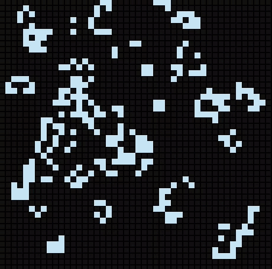
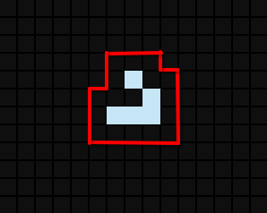
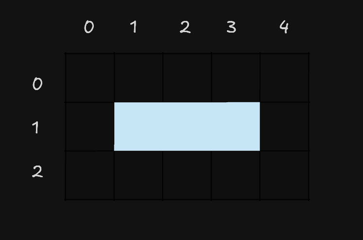
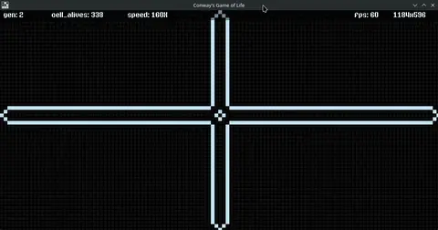
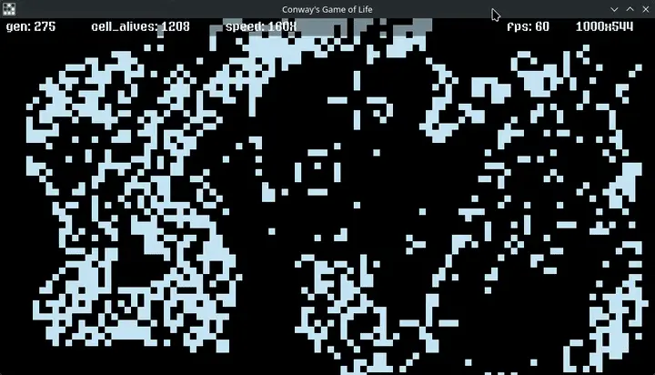

# Conway-s-game-of-life

[](https://opensource.org/licenses/MIT)
[](https://www.python.org/)
[](https://www.pygame.org/)

## Tabla de Contenidos

- [Acerca del proyecto](#acerca-del-proyecto)
- [Comportamiento](#comportamiento)
  - [Generaciones](#generaciones)
- [Implementación](#implementación)
- [Optimizaciones](#optimizaciones)
  - [Analizando estados](#analizando-estados)
  - [Subproblemas superpuestos](#subproblemas-superpuestos)
- [Instalación y Uso](#instalación-y-uso)

## Acerca del proyecto

Hace un año, me topé con un juego llamado `game-of-life` creado por el matemático británico John Conway. Me pareció absolutamente fascinante cómo, con tan solo 4 reglas simples, podía simular un comportamiento tan complejo y extraordinario. Motivado y emocionado, decidí implementar este juego utilizando Python y Pygame para darle vida. El resultado es una atractiva visualización que nos permite comprender cómo se comporta el juego y observar la infinidad de patrones que emergen a partir de una simple configuración inicial de células vivas.

<div align="center">
  
</div>

## Comportamiento

El Juego de la Vida se desarrolla en una cuadrícula bidimensional infinita donde cada posición representa una célula que puede estar en uno de 2 estados: viva o muerta. Para determinar el estado de una célula en la siguiente generación, entran en juego las 4 reglas simples establecidas por John Conway:

- Cualquier célula viva con menos de dos vecinos vivos muere, como por infrapoblación.
- Cualquier célula viva con dos o tres vecinos vivos sobrevive para la siguiente generación.
- Cualquier célula viva con más de tres vecinos vivos muere, como por sobrepoblación.
- Cualquier célula muerta con exactamente tres vecinos vivos se convierte en una célula viva, como por reproducción.

Estas reglas reflejan los sistemas naturales de formas fascinantes: las células mueren por aislamiento o hacinamiento, pero la nueva vida emerge cuando las condiciones locales son las adecuadas. Es por eso que se llama el Juego de la Vida: simula la vida, determinando la supervivencia a través de solo cuatro reglas elementales.

#### Generaciones

El juego progresa a través de generaciones; cada generación es una iteración del estado actual del mundo donde la aplicación de las reglas produce un nuevo patrón. Puedes ejecutar tantas generaciones como desees o dejar que computen indefinidamente. Pero, ¿se detiene alguna vez la ejecución? Sí. Dependiendo de la configuración inicial, una simulación puede alcanzar un estado donde todas las células mueren; esto se considera un estado terminal. Alternativamente, una configuración inicial puede llevar a generaciones infinitas si entra en un estado repetitivo donde un conjunto de células vivas forma un patrón cíclico que vive y muere en un bucle, conocido como oscilador o estructura cíclica.

## Implementación

Para efectos prácticos, este proyecto modela un mundo finito de tamaño $N \times M$. El mundo se representa como una matriz donde cada posición guarda el estado de una célula (0 representa una célula muerta y 1 representa una célula viva). Durante cada iteración (generación), inspeccionamos los vecinos adyacentes —incluidas las diagonales— de cada célula para determinar su siguiente estado. La lógica y las reglas del juego están implementadas en un motor en Python, mientras que Pygame se encarga del renderizado visual.

### Mapa de calor

Una característica interesante es el mapa de calor, que nos permite observar la frecuencia de células vivas a lo largo de cada generación; también podemos ver qué partes del mapa tuvieron una mayor concentración de células vivas.

## Optimizaciones

### Analizando estados

Al probar configuraciones en cuadrículas finitas más grandes, noté que la sobrecarga computacional crecía rápidamente con el tamaño del mundo. Para cuadrículas grandes, evaluar cada una de las $N \times M$ celdas en cada turno causaba caídas severas de rendimiento. Por ejemplo, una matriz de $10000 \times 10000$ requiere evaluar 100,000,000 de celdas en cada generación, lo que resulta en una complejidad temporal de $O(N \times M)$ (u $O(N^2)$ para matrices cuadradas).

<div align="center">
  
  <p>Matriz de 25x25, Células vivas: 5</p>
</div>

##### Solución

Examinar de cerca el problema planteó una pregunta natural: _¿Y si no necesitamos escanear el mundo entero?_

En lugar de verificar todas las $N \times M$ posiciones, podemos restringir nuestro enfoque a las áreas con mayor probabilidad de cambiar de estado: **las células vivas y su vecindario inmediato**. Concentrarse en las células vivas (ya que impulsan las transiciones de los vecinos) reduce el escaneo de toda la cuadrícula a rastrear $N$ células vivas por generación ($O(N)$).

En lugar de procesar todo el tablero, solo inspeccionamos el vecindario de $3 \times 3$ (9 celdas candidatas) alrededor de cada célula viva. Para decidir si cada candidata vive o muere en la siguiente generación, evaluamos sus propios $3 \times 3$ (9) vecinos. Esto produce un límite superior de $N \times (3 \times 3) \times (3 \times 3) = 81N$ operaciones por generación.

<div align="center">
  
  <p>Área de búsqueda delimitada</p>
</div>

##### Ejemplo práctico

Tomando la generación ilustrada arriba en un mundo de $25 \times 25$ (625 posiciones totales) con solo 5 células vivas ($N = 5$):

- **Enfoque tradicional:** Evalúa las $625$ celdas de la matriz.
- **Enfoque centrado en células vivas:** Evalúa $5 \text{ células} \times 9 \text{ candidatas} \times 9 \text{ vecinos} = 405 \text{ operaciones}$.

Dado que $405 < 625$, este enfoque reduce significativamente las operaciones totales por ciclo.

#### Efectos secundarios

Vale la pena señalar algunos casos límite:

- **Alta densidad de células vivas:** A medida que el número de células vivas $N$ crece, $81N$ aumenta y eventualmente puede superar el costo de escanear la cuadrícula completa. Afortunadamente, debido a las reglas de Conway, una alta densidad sostenida en toda una cuadrícula grande es poco común en la práctica.
- **Ineficiencia en tableros pequeños o densos:** En un tablero de $10 \times 10$ (100 celdas totales) con 5 células vivas, $5 \times 81 = 405$ operaciones. Aquí, $405 > 100$, causando reevaluaciones redundantes que superan el escaneo de todo el tablero.

Resolvemos esta ineficiencia utilizando **programación dinámica**.

---

### Subproblemas superpuestos

Concentrarse en las células vivas reduce el trabajo innecesario, pero los vecindarios superpuestos aún introducen verificaciones redundantes cuando las células vivas se encuentran cercanas entre sí:

<div align="center">
  
  <p>Matriz de 3x5, Células vivas: 3</p>
</div>

En este minimundo de $3 \times 5$, las células vivas se encuentran en las posiciones `(1,1)`, `(1,2)` y `(1,3)`. Evaluar la célula `(1,1)` verifica todas las posiciones en las que puede influir, incluyéndose a sí misma: `(0,0), (0,1), (0,2), (1,0), (1,1), (1,2), (2,0), (2,1), (2,2)`.

El algoritmo evalúa estas coordenadas para calcular su estado en la siguiente generación:

```text
(0,0) -> 0
(0,1) -> 0
(0,2) -> 1
(1,0) -> 0
(1,1) -> 0
(1,2) -> 1
(2,0) -> 0
(2,1) -> 0
(2,2) -> 1

```

A continuación, evaluar la célula viva `(1,2)` apunta a sus vecinos: `(0,1), (0,2), (0,3), (1,1), (1,2), (1,3), (2,1), (2,2), (2,3)`:

```text
(0,1) -> 0 <- Duplicado
(0,2) -> 1 <- Duplicado
(0,3) -> 0
(1,1) -> 0
(1,2) -> 1 <- Duplicado
(1,3) -> 0
(2,1) -> 0
(2,2) -> 1 <- Duplicado
(2,3) -> 0

```

Varias posiciones se recalculan porque se superponen con el vecindario de `(1,1)`.

#### Solución

Para eliminar estos cálculos duplicados, aplicamos un **patrón de programación dinámica (top-down con memoización)**.

A medida que se procesa cada celda candidata, su coordenada se agrega a un **`set()`**. En las verificaciones posteriores, consultamos el conjunto para ver si la posición ya fue evaluada durante la generación actual. Esto garantiza que cada posición candidata se calcule **exactamente una vez** por ciclo.

## Vistas previas

<div align="center">
  
</div>
<br>
<div align="center">
  
</div>

## Instalación y Uso

Para ejecutar y ver la simulación localmente, sigue estos pasos:

### Requisitos previos

Asegúrate de tener instalado:

- **Python 3.x** (preferiblemente 3.12 o superior).
- **Pip** (administrador de paquetes de Python).

### Pasos de instalación

1. **Clona este repositorio:**

```bash
git clone https://github.com/suaadev/conway-s-game-of-life.git
cd conway-s-game-of-life

```

2. **Crea un entorno virtual (Recomendado):**

```bash
python -m venv venv

# En Windows:
venv\Scripts\activate

# En macOS y Linux:
source venv/bin/activate

```

3. **Instala las dependencias:**
   Este proyecto depende de `pygame` para el renderizado de gráficos y de `numpy`.

```bash
pip install -r requirements.txt

```

### Ejecución

Para iniciar la interfaz gráfica (GUI) y ejecutar la simulación:

```bash
python src/main.py

```

### Controles

- **Clic Izquierdo:** Colocar una célula viva.
- **Clic Derecho:** Eliminar una célula viva.
- **Tecla ESPACIO:** Iniciar / Pausar la simulación.
- **Tecla C:** Limpiar el tablero y reiniciar el mundo.
- **Tecla B:** Alternar visibilidad de la cuadrícula.
- **Tecla F:** Alternar visibilidad del mapa de calor.
- **Tecla N:** Aumentar el tiempo entre generaciones (más lento).
- **Tecla M:** Disminuir el tiempo entre generaciones (más rápido).
